# Informe — Actividad 3.1 CRUD con Room, DataStore, ViewModel, Notificaciones y Despliegue

**Alumno/a:** Ernesto de Jesús Beltrán Marmolejos  
**Fecha:** 16 de octubre de 2026  
**Enlace al repositorio:** [Repositorio PMDM2627](https://github.com/edebm34/PMDM2627/tree/main/Login)

> Si se ven mal las capturas están íntegras en el directorio `capturas` y en su resolución original en `capturas/completo`.

## 1. Diagrama de navegación
 
La app tiene tres pantallas: **Login**, **Registro** y **Home**.
 
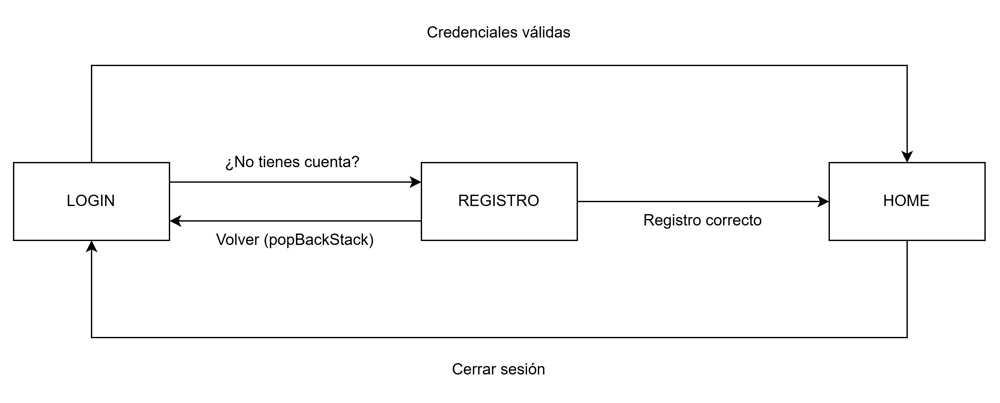

## 2. Wireframes
 
### 2.1 Login
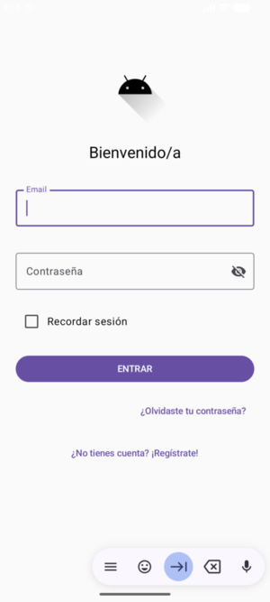
### 2.2 Registro
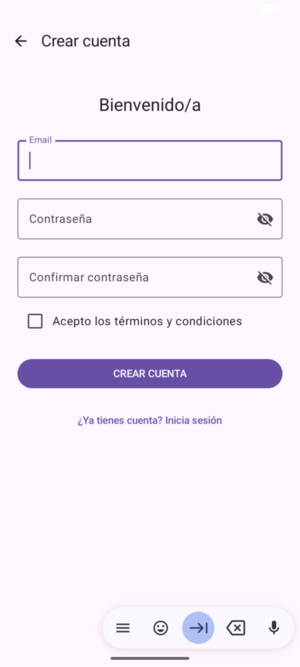
### 2.3 Home sin elementos
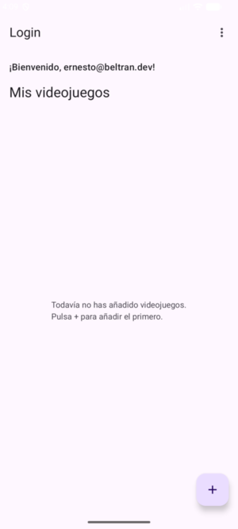
### 2.4 Home con elementos
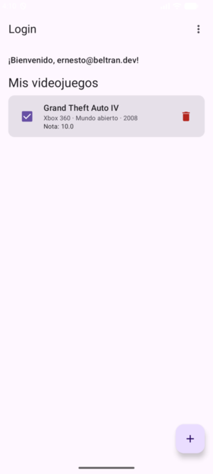
### 2.5 Nuevo videojuego
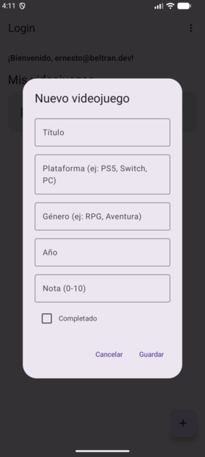
### 2.6 Acerca de
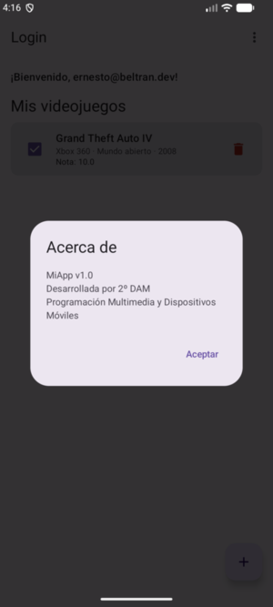
 
## 3. Decisiones de diseño
 
**¿Por qué DataStore?**
Para guardar la sesión solo necesitamos dos datos: el email y si el usuario quiere que se recuerde su sesión. DataStore sirve justo para eso y no bloquea la app.
 
**¿Por qué Room?**
Los videojuegos tienen varios campos (título, plataforma, género, año, nota, completado) y hay que poder añadir, editar y borrar. Room es una base de datos para eso, y además avisa a la pantalla cuando los datos cambian, así la lista se actualiza sola.
 
**¿Por qué ViewModel?**
Guarda los datos de la pantalla y la lógica, y no se pierde al girar el móvil. Así los composables solo se ocupan de dibujar.
 
**¿Por qué un repositorio?**
Es el intermediario entre la pantalla y los datos (Room y DataStore).
 
## 4. Estrategia de validación
 
### Login y Registro
 
| Campo | Regla |
|---|---|
| Email | Que tenga formato de email válido |
| Contraseña | Mínimo 8 caracteres, una mayúscula y un número |
| Confirmar contraseña (solo Registro) | Que sea igual a la contraseña |
| Términos (solo Registro) | Tienen que estar aceptados |
 
Los errores salen en rojo debajo del campo, tanto al escribir como al pulsar el botón. Solo se avanza si todo es correcto.
 
### Formulario de videojuegos
 
| Campo | Regla |
|---|---|
| Título | No puede estar vacío |
| Año | Solo números, entre 1950 y 2100 |
| Nota | Número entre 0 y 10 |
| Plataforma, género, completado | Sin validación (opcionales) |
 
## 5. Estrategia de persistencia
 
| Lo que se guarda | Dónde | Por qué |
|---|---|---|
| Email | DataStore | Es un dato suelto y se muestra en Home |
| «Recordar sesión» | DataStore | Decide con qué pantalla arranca la app |
| Videojuegos | Room | Son muchos datos con varios campos |
 
Al cerrar sesión se borran los datos de DataStore, mientras que los videojuegos se quedan guardados.
 
## 6. Permisos: `POST_NOTIFICATIONS`
 
- La app muestra una notificación cuando se añade un videojuego.
- Desde Android 13 hay que **pedir permiso** al usuario para mostrar notificaciones. *(Indicar cuándo y cómo se pide en `HomeScreen.kt`.)*
- Si el usuario lo rechaza la app funciona igual, solo que no aparece la notificación.
## 7. Despliegue

- **Ruta:** C:\Users\Tarde\.keys\upload-keys.jks
- **Alias:** upload-keys
- **Comando:** adb install app-release.apk
- **Dispositivo:** Medium Phone API 37.1 (emulador)
 
## 8. Capturas de pruebas
 
### 8.1 Login
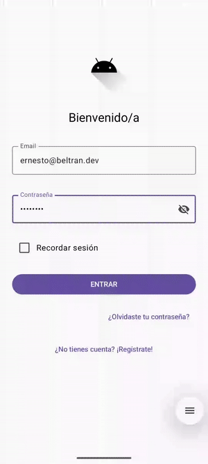
### 8.2 Auto-Login
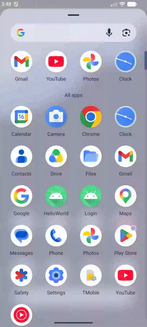
### 8.3 Agregar juego
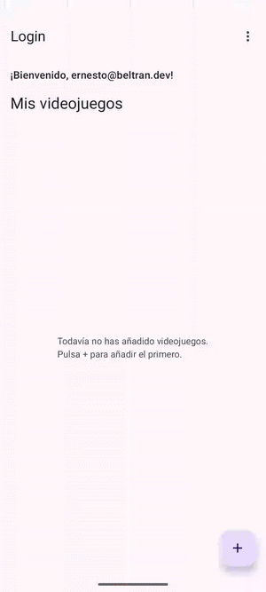
### 8.4 Borrar juego
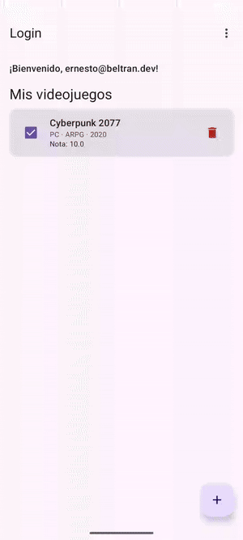
 
## 9. Dificultades encontradas
 
El error más destacable que sufrí mientras hacía la tarea es que al tener yo un artefacto distinto (`io.github.edebm34` en vez de `com.ejemplo`) pues después de copiar y pegar el código del ejercicio me venía con muchísimos errores, pero simplemente corrigiendo el paquete de cada archivo se arregló todo.